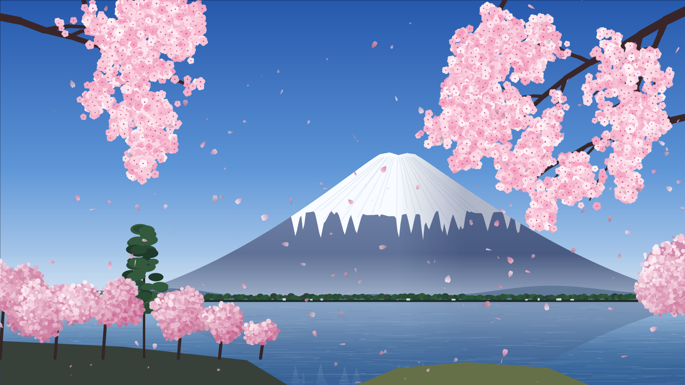
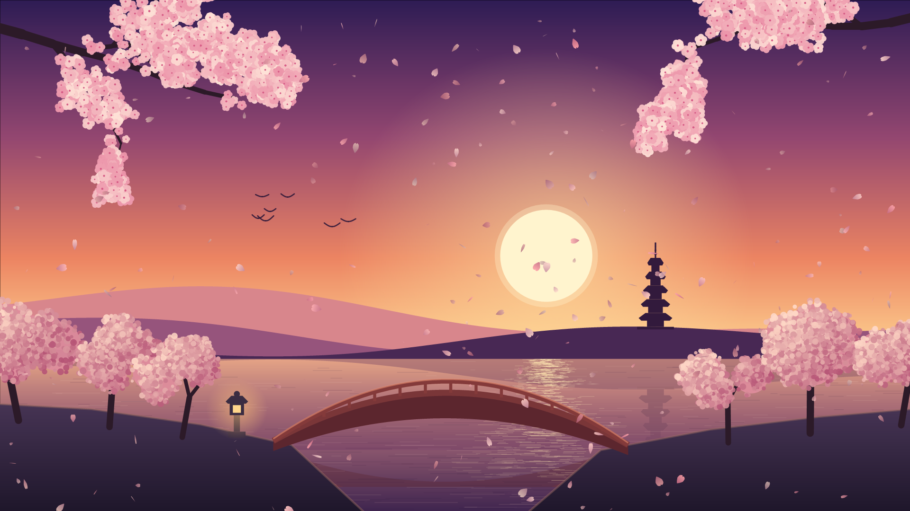
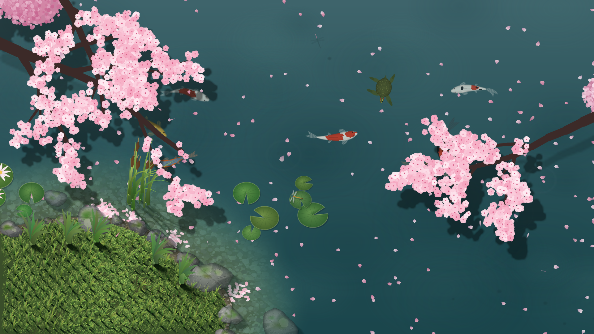
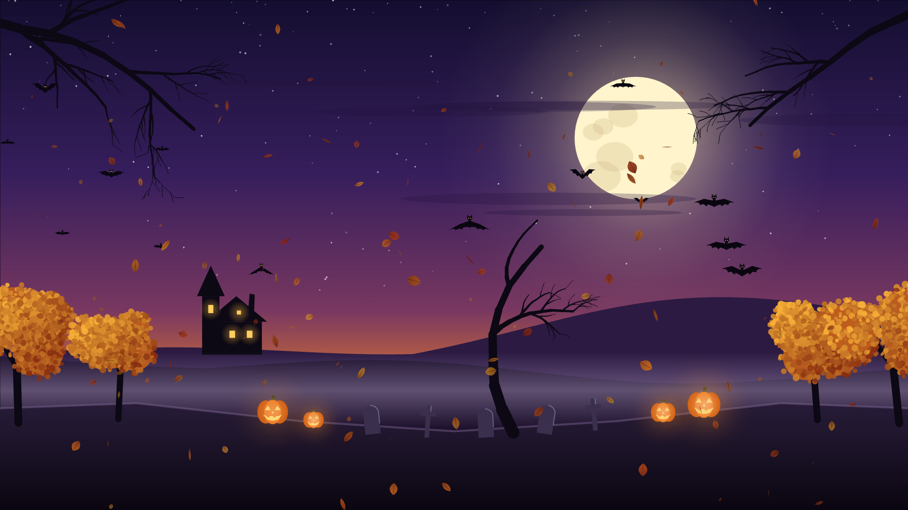
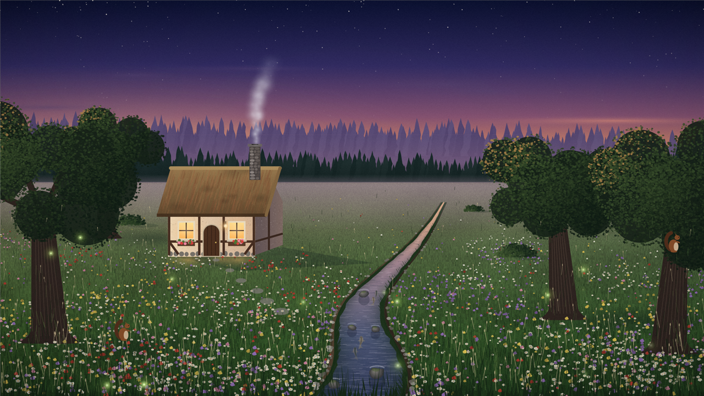

# Peckworks Screensavers

Native Windows screensavers written in C# (.NET 10, Windows Forms), plus a small reusable engine
for making more of them. So far: **Matrix Rain**, **Sakura**, **Sakura Dusk**, **Sakura Pond**,
**Halloween**, **Christmas** and **Cabin by Stream**.

## Matrix Rain

A close replica of the "digital rain" from *The Matrix* (1999): mirrored half-width katakana,
near-white flickering leading characters, fading green tails, characters that mutate in place,
drops at varied speeds and brightness, and a soft phosphor glow.


Settings: speed, density, character size, glow.

## Sakura

White and pink cherry blossom petals drifting down like snow over a painted scene of Mount Fuji
across a lake, framed by branches in full bloom. Stylized rather than photorealistic.



- Petals tumble, spin, sway, and ride a breeze that rises and settles.
- Depth: near petals are bigger, faster, and more opaque than far ones.
- Some petals let go of the blossoms on the branches; light glints on the lake.
- Trees stand on two banks of land in front of the lake, with a pine behind the grove.
- A small wooden boat with a roofed cabin, a boatman in a straw hat and a red lantern drifts
  slowly across the lake, passing behind the banks and trees.
- Branches and trees are grown randomly, so each run looks a little different.
- Twenty small **happenings** come and go at random, one every 5 to 12 seconds:

  | Where | What happens |
  |-------|--------------|
  | Fuji and the sky | A lens-shaped cap cloud (kasa-gumo) forms on the summit. The mountain blushes red, like Hokusai's Red Fuji. The sun crests the summit and blazes into a "Diamond Fuji". Origami paper cranes glide past. A painted kite dances on its string. A rainbow arcs over the lake. Cloud shadows drift across the mountain and the water. |
  | The far shore and the lake | A shinkansen races along the far shore. A sun shower glitters down and dimples the lake. A raft of fallen petals (hanaikada) drifts by. A mother duck leads her ducklings across. A kingfisher dives for a fish. Swallows skim the water. |
  | The banks | A heron stands in the shallows and strikes. A Shiba Inu trots along the hill, sits and smiles. Butterflies dance around the blossom trees. |
  | The branches | A pair of white-eyes (mejiro) visits the blossoms. A squirrel scampers along a branch. A glass wind chime (furin) swings and rings. |
  | Everywhere | A gust tears a blizzard of petals (hanafubuki) off the branches and sweeps it past you. |

Settings: number of petals, fall speed, breeze, petal size, and how often a surprise happens
(0 turns them off).

## Sakura Dusk

The same slowly falling petals over a different painting: a pond at sunset, with a low sun
setting behind hazy hills, a pagoda on the far shore, an arched wooden footbridge, a stone
lantern with a glowing window, and cherry trees on both banks. A small flock of birds flaps
slowly across the sky, each bird on its own rhythm, gliding now and then.



- Petals are tinted by the evening light, and golden glints twinkle in the sun's reflection.
- The nearest hills, the pagoda, and the bridge are mirrored faintly in the still water.
- The same boat as Sakura's, here a small silhouette far out near the opposite shore.
- Twenty happenings of its own, none shared with Sakura:

  | Where | What happens |
  |-------|--------------|
  | The sky and the sun | The sun's top edge flashes green. Rays of light fan up from the sun. The first star of evening appears and twinkles, then others. A crescent moon sinks behind the hills. Golden clouds drift by. The light deepens into a richer "magic hour". A crane flies across the face of the sun. |
  | The hills | A procession of fox lights (kitsune-bi) winds along the hills. |
  | The pond | Paper lanterns float across the water (toro nagashi). Koi glide under the surface. A lotus opens. Mist gathers over the water. A breeze ripples across the pond. A frog leaps in, as in Basho's haiku. |
  | The bridge and the banks | A cat crosses the bridge and sits to watch the sunset. Red paper lanterns light up along the rail. A tanuki waddles along the bank and tries to catch a petal. The cherry trees light up from below (yozakura). |
  | The air | Fireflies rise from the banks. Red dragonflies dart over the pond. |
- The same settings as Sakura (petals, fall speed, breeze, petal size, surprises), saved separately.

Sakura and Sakura Dusk share one petal engine and one set of painting brushes (banks, trunks,
blossoms, branches) in the Core project, so they have the same illustrative hand.

## Sakura Pond

A koi pond seen from above, the way you see one leaning on the rail of a bridge. The pond is
bigger than the view: still water fills the screen under cherry branches in full bloom, and the
only shore in sight is a corner of lawn at the bottom (left or right, the seed decides). Rocks
of every size sit along the water's edge, each with a sunny face, a shaded face, moss and lichen,
their lower flanks darkening under the water as it wraps round them; a strip of damp sand and
pebbles runs between them and the grass; clumps of iris leaves stand on the lawn behind the
stones, arching out over them toward the water; a clump of cattails stands in the shallows, brown
heads nodding; lily pads and water lilies float in the calm water nearby; and the branches throw
dappled shadows on the water. The lawn is long grass in a breeze: a band of bent, lightened blades
rolls across it as each gust passes, and tufts of taller grass lean over and spring back as the
wave reaches them. There is ONE wind: the lawn, the tufts, the cattails, the irises and the
falling petals all read the same gust at the same moment, so a gust crosses the scene as one
travelling wave (the cattails and irises sway with it stiffly).



- **Koi** of eight real varieties (kohaku, sanke, showa, yamabuki ogon, chagoi, asagi, tancho,
  plain red-orange) cruise the whole pond: a few tail beats, then a long glide. Each body bends
  through its turns along the path its head swam, never flipped or slid. They swim at real depths:
  the pond has a bed that slopes up to the bank and to every rock, a fish is never deeper than
  the water under any part of its body and rises up the slope before the shallows, a deep fish
  sits lower on the screen than the water above it (we look at the pond at a slant) and comes up
  the screen as it rises, and in the shallows it throws a shadow on the bed, a soft echo right
  under it that fades as it rises off the bed (never thrown far: a shadow a body length away
  reads as a fish hovering above the water). A deep fish is
  smaller, hazier, softer and dimmer than one at the top, so when one passes over another you
  can tell from above which is over which, and the near one leaves a soft dark echo of itself
  on the deeper one's back where they overlap. They slip under the lily pads, and now and then
  come up to gulp at the surface, leaving a ring. The pond is deep enough to hide a fish: the
  fish swim at any depth the bed allows, go smaller and hazier the deeper they are, and then out
  of sight. They steer over, under and round each other in three dimensions, and if two do touch
  they bump (a short recoil, then a shy swim away) rather than pass through. The 3D navigation
  kit behind this lives in the engine (`Core/Minds/Space.cs`) for other savers to use. A diving
  fish tilts: every point of its body is as deep as its head was when it passed there, so the
  head goes smaller, hazier and lower on the screen before the tail does, and a fish diving out
  of sight goes head first, tail last; one hanging still levels out. Hovering, its side fins
  scull by turns, one sweeping back as the other comes forward, the slow treading that holds a
  koi in place; swimming, they beat together. The sun gleams along its back, down the backbone
  when it heads toward or away from the sun and out on the sunward flank as it turns across the
  light, brightest on the metallic varieties and fading with depth. Nothing in the pond passes
  through a floating petal: whatever has its back up at the surface (a koi gulping or brushing
  it, a paddling turtle, the snake) shoves the petals in its way aside, and they glide off and
  slow; a fish swimming under them leaves them be.
- **An island rock** stands out in the open water: a boulder that goes down deep, darker and
  bluer the deeper it goes until the water hides it, with a small dry cap breaking the surface.
  The koi swim up and over its shoulders and round the cap. Once in a while one rises slowly until its back brushes the
  surface from below, and three thin, slow rings slip off it as it glides on.
- **Goldfish** (three by default, a "Goldfish" knob from 0 to 6) share the pond with the koi: a short, deep-bodied
  wakin under half a koi's length, orange-red, red and white, or a pale calico, trailing a long see-through forked tail
  that flutters behind it. It is the same fish in the same water (same body, steering, depth and bump rules), but it keeps to
  the sunlit top of the pond, beats quicker, nibbles at the surface twice as often, flinches from a swallow's shadow from further
  off, follows other goldfish far more readily than a koi, never chases a koi, and idles in the neighbourhood of a shoalmate,
  so three of them drift about as a loose little shoal.
- **Each koi has a mind of its own.** Three personality dials are dealt when it is born (spread
  across the school, so near-twins are rare): how
  energetic it is (how much it beats rather than glides, how fast it cruises), how sociable, and
  how curious. From those it decides, one thing at a time, what to do next: wander, rest deep and
  still, go and nose at something (a floating petal, which it may gulp down, the rim of a lily
  pad, the foot of the cattails, the side of the floating log, or the spot where a dragonfly just
  tapped the water), swim along behind and beside a friend, or now and then burst after another
  fish, which speeds up and swerves away until the chaser loses interest. Only one chase runs in
  the pond at a time, and a curious fish answers a dragonfly's tap far more often than a dull one.
  When a swallow skims low over a fish, its shadow makes the fish dart away and dive, and it sulks
  deep for a while; a bold fish (energetic and sociable) barely notices, a timid one flinches at a
  shadow some way off. And now and then a koi LEAPS: a burst up from an unhurried cruise, half a
  second clear of the water (it rises up the screen with its shadow left on the water, the way
  a falling petal or a perched turtle shows its height), a splash of rings and flung drops, and
  the fish nearby flinch from it; then it dives to get over itself. About one a minute or two
  somewhere in the pond, more from an energetic fish, never from a goldfish. The lizards and the snake think
  the same way, on the same shared parts
  (`Core/Minds`); how to give any animal in any saver a mind is [docs/MINDS.md](docs/MINDS.md).
- Two **schools of minnows**, a dozen or so tiny fish each, hang just under the surface and move
  as one: all facing the same way, fidgeting in little darts, flashing silver when the whole
  school turns, and scattering like thrown rice when a koi cruises underneath. Each minnow is a
  bending body on its own trail, like the koi in miniature.
- **The dragonfly's game**: every so often a dragonfly flies over to a school, hovers, then skims
  low and taps the water three times in a short line, each tap a small ring. The minnows rush to
  the rings in a body and circle under the spot, nipping at the surface where the dragonfly
  touched (a fizz of tiny rings). The dragonfly darts off across the pond, wanders, and comes back
  a little later to do it again, taking the schools in turn.
- A **turtle** (a red-eared slider, the turtle of nearly every park pond in Japan) paddles just
  under the surface, front left leg with back right and then the other pair, with a small surge
  on each stroke, turning as one rigid piece in wide slow arcs, its head leading each turn on
  its neck. It steers in three dimensions like the koi: its feelers take it over, under or round
  a fish in its way, and where the two still meet (about ten times in three minutes) the fish is
  pushed out of it; its rise and sink while it paddles are held to what the paddling can hide,
  so it never slides up or down the screen. Now and then it stops, spreads
  its legs and floats up (a buoyant rise at one slow rate whichever way it faces: it grows and
  sharpens as it comes, which reads as surfacing), pokes its nose up for a breath (one small ring), drifts over to a petal
  and nibbles it, then paddles off, or
  dives to the bed for a while. And it hauls out: it swims up to the island rock or the fallen
  log, climbs onto it, sits with its legs spread in the sun for fifteen seconds to a minute, and
  slips back in (sooner if the snake comes near, and then on the side away from it). Each turtle has its own dials: how much it loves the sun
  and how jumpy it is.
- **Frogs** (tonosama-gaeru, the Japanese pond frog) sit on the lily pads, the dry bank rocks and
  the bank's edge, olive green with brown blotches and a pale line down the back, two bulging
  eyes on top of the head. A frog sits still for half a minute at a time, its pale throat
  fluttering and now and then swelling in a croak (no sound), with the odd shuffle or hop round
  on the spot to face the water; a bold one snaps at a dragonfly that settles close. Then it
  leaps: a crouch, the hind legs snapping out behind, an arc a few body lengths long with its
  shadow left behind on the pad and then the water (the gap is the height), and a splash. It
  swims with frog kicks (a quick push that surges the body, then a slow glide with the legs
  folding forward), floats with its legs hanging, steers round pads and the bank, and climbs
  out onto another pad or the bank with a short hop and turns to face the water. Frightened by
  the snake, a koi's head, a turtle, a lizard or a swallow's shadow, a sitting frog leaps in and a
  swimming one dives (hazy and smaller as it goes down, back up with a tiny ring). A frog in the
  water is solid to the koi (they steer round it and a fish that meets it is pushed out) and
  shoves the floating petals aside. Each frog has its own two dials: how bold and how restless.
- **Petals** let go of the blossom, sway and tumble down, their shadows sliding in to meet them,
  touch the water with a tiny ring, then float, drifting slowly and gathering against the banks.
- **Dragonflies** (shiokara tombo, the pale blue dragonfly of Japanese ponds) hover, dart and stop
  dead, perch on lily pads, and the golden female dips to touch her tail to the water.
- **Swallows** visit to drink: low, fast, sweeping curves with bursts of wingbeats and swept-back
  glides, skimming the surface with a line of rings, their shadows racing below them.
- Now and then a **snake** (a shimahebi, the four-lined rat snake) comes out of the grass, swims
  across the pond with its body weaving behind its head and a small wake, and slips away. It is
  not on rails: it feels its way, goes round the lily pads, the rocks, the log, the cattails and
  the iris clumps rather than over them, pushes the floating petals out of its way, and if a
  koi, a turtle or the lizard touches it, it startles: a burst of speed, a swing away, rings off its head, then it calms. The koi and
  turtles treat its body as solid (they steer under or round it, and a fish that meets it is pushed out), and the minnows keep
  clear of it as they do of the koi. Each visit is a different snake: it rolls a boldness and a
  nerve, and then chooses what to do by weighted dice, a few things per visit. It may swim out
  to a spot in open water and then another (explore), creep up on a school of minnows and
  lunge at it with a ring off its head while the minnows scatter (hunt), or, when the log is
  afloat, swim to the log's end, climb on, lie along it for 10 to 30 seconds in a gentle S and
  slip off the far end (bask). A bold snake hunts and basks more and calms sooner; a nervous one
  just crosses, startles at a longer reach and stays frightened longer. It always ends by
  leaving across the far side.
- Two **lizards** (kanahebi, the Japanese grass lizard with the very long tail) each come out on
  the bank every couple of minutes: a dash, dead still, another dash, over the grass and up onto a
  rock to bask, its body and tail throwing an S-wave as it runs and its legs stepping on opposite
  corners, then gone into the grass again. Each has its own temper, rolled once: a BOLD one stays
  out longer, basks longer and wins a standoff, an ENERGETIC one makes longer dashes with shorter
  rests. They also run to the water's edge and drink (one tiny ring in front of the nose), creep
  up on a dragonfly sitting on a bank rock (it takes off a body length short), bolt for cover
  when a swallow's shadow sweeps over them, and if
  both are out and meet, they square up nose to nose, then the bolder one charges and the other
  bolts away and leaves. Both run for the nearest edge if the snake comes close.
- A **field mouse** (akanezumi) lives in the bank's grass. It comes out at the screen's edge for
  half a minute or so, then goes: a plump brown oval with a round head, two pink-lined round ears,
  bead eyes, four tiny feet and a thin tail nearly as long as itself. It moves in scurries of a
  third of a second, tail streaming, and between them stops dead to sniff (the nose twitches), sit
  up on its haunches, groom (a quick shiver) or nibble with its head down. It keeps to cover: it
  prefers the grass and the foot of a rock or the log, crosses bare sand only when it must, now and
  then runs along the log, and goes to the water's edge for one tiny sip. It is prey: the snake's
  head, a lizard's nose or a swallow's shadow sends it bolting for the nearest grass, where it very
  often vanishes (a short fade) for 10 to 40 seconds and comes back out at the same spot. Each has
  two dials rolled once: a TIMID one flees sooner and from further, freezes more and leaves
  sooner; a GREEDY one stays longer, nibbles more and drinks more.
- A fallen **log** lies at the lower left, different every time: beached across the water's edge
  with one end in the grass and the other in the shallows when the land is in that corner, or
  drifting out on the water when it is not. Bark streaks, cracks, a knot or two, moss on top, and
  the cut end's rings where it faces us.

Settings: draw width (sharpness against smoothness), petals, number of koi (ten by default), number of goldfish (three by default), how playful the koi are (0 means they only cruise and rest),
number of minnow schools (0 means no game), number of turtles, number of frogs (two by default),
number of dragonflies, how often the swallows visit, how often the snake crosses, how many
lizards there are (0 to 3), how often the lizards come out (Lizard visits), and how many field
mice live in the grass (0 to 3).

On a screen wider than the "Draw width" setting (2048 pixels by default) it draws at that width
and Windows enlarges the picture: the scene is soft and painterly, so the enlarging loses little,
and fewer pixels is what keeps a steady 60 frames a second on a 4K laptop (2560 is sharper and
runs at an even 30 there). If a frame cannot be drawn and shown inside one screen refresh, the
engine now holds an even 30 frames a second instead of juddering between 16 and 33 ms gaps.

## Halloween

Autumn leaves in gold and red drifting down over a moonlit graveyard hill: a big full moon, a
haunted house with lit windows on the far hill, a dead tree, tombstones, a waving skeleton, autumn
trees, and bare branches clawing in from the top corners.



- Bats flap across the sky in three sizes, swooping as they go.
- The jack-o'-lanterns flicker like candles, and the skeleton waves.
- The leaves are the Sakura petal engine with a leaf outline, and they let go of the autumn trees.
- Nineteen small **happenings** come and go at random, one every 5 to 12 seconds, shuffled like a
  deck of cards so you see them all before any repeats:

  | Where | What happens |
  |-------|--------------|
  | The sky | Halloween fireworks (purple and orange, or green) burst and sparkle. A shooting star. A bolt of lightning. Stars join up into a constellation (a bat, a pumpkin, a ghost...). Three little ghosts float past in single file. |
  | The moon | The moon turns blood red. A witch on a broomstick flies across it. |
  | The far hill | The haunted house's windows flicker out and come back green. A cloud of bats pours out of its tower. Something huge with glowing eyes peeks over the hill. |
  | The graveyard | A ghost rises from a grave and says boo. A zombie hand claws up out of the ground. Will-o'-the-wisps drift among the stones. The skeleton's eyes glow red. A jack-o'-lantern changes its expression. A black cat trots through. |
  | The trees | A spider spins a web in the dead tree, strand by strand. Another lowers itself from a branch on a thread. Pairs of eyes open in the dark. |

Settings: number of leaves, fall speed, breeze, leaf size, number of bats, and how often a
surprise happens (0 turns them off).

Adding more happenings, here or to another screensaver, is a recipe:
[docs/ADDING_HAPPENINGS.md](docs/ADDING_HAPPENINGS.md).

## Christmas

Snow falling on a snowy night: pines strung with pastel lights that twinkle, a log cabin with
warm windows and a smoking chimney, snowy mountains, and a moon.


- Santa's sleigh crosses the sky, passing behind the overhanging branches, pulled by four
  galloping reindeer. Rudolph leads, and his red nose glows and sparkles.
- Every bulb (pink, mint, baby blue, lavender, butter, peach) brightens and dims on its own rhythm.
- The snow is the Sakura petal engine drawing soft white dots.
- Twenty small **happenings** come and go at random, as in Halloween:

  | Where | What happens |
  |-------|--------------|
  | The sky | A shooting star to wish on. The northern lights ripple. Stars join up into a snowflake, a star, a tree, a candy cane or a bell. Festive fireworks (gold and silver, red and green, or icy blue). A gust of wind whirls snow across. A drift of golden fairy dust swoops through. |
  | The moon | An ice halo with a faint rainbow forms around it. |
  | Santa | A present tumbles off the sleigh and lands in the snow. |
  | Far off | A toy train with lit windows crosses the valley. A reindeer stands on the mountain ridge. |
  | The snow | A fox trots through and stops to sniff. A rabbit hops by. A snowman builds itself and waves. A snowball rolls across, growing. A clump of snow slides off a pine. |
  | The cabin and the lights | Smoke rings (and a heart) from the chimney. A wave of brightness runs through every light. The star on the tree flares and showers sparkles. |
  | The corners | Frost crystals grow across a corner of the glass. A snowy owl perches on a branch and blinks. |

Settings: amount of snow, fall speed, breeze, flake size, and how often a surprise happens
(0 turns them off).

Halloween and Christmas are built from the same shared pieces as the Sakura pair (the falling
engine, the ground, trees, hills and branches), plus one new one: sprites, small pictures painted
once and stamped each frame, which is how the bats, the sleigh and every moving light (candles,
bulbs, Rudolph's nose) are drawn.

## Cabin by Stream

A flowery meadow at dusk, painted to look as much like a photograph as a painted scene can: a
small thatched cottage with lit windows and white smoke rising from its chimney, a stream winding
toward you with trout holding in the current, squirrels running between the trees and up them,
and fireflies blinking over the grass. The last of the sunset glows low on the left; the first
stars are out overhead; mist lies at the feet of the far forest.



- The grass is textured pixel by pixel (coarser near you, hazier far away), with thousands of
  small wildflowers in drifts, blades and seed heads in the near meadow, long soft shadows that all
  fall away from the glow, and a camera's vignette and grain over the whole picture.
- The smoke is a crowd of puffs that rise fast while hot, slow as they cool, spread, lean with the
  breeze and thin away.
- The trout face upstream, drift slowly back and dart forward to hold their place, seen through
  the water. Light slides down the stream's surface.
- Each squirrel follows a plan: sit, run to the next tree (sometimes stopping to sit up and look
  about), climb, sit on the trunk, come down head first, run back.
- Fireflies blink on their own slow cycles and are mirrored in the stream when they cross it. The
  windows and the door lamp flicker like firelight; the brighter stars twinkle.
- No happenings yet.

Settings: fireflies, number of fish, number of squirrels, chimney smoke, breeze.

## Retired: Cotswold Brook

A real photograph of Cotswold cottages by a brook, with ripples, trout, smoke, a falling dusk,
fireflies and mist animated over it. Retired: its fish were flat stickers that only faced left
or right, flipped to turn and slid about, swimming under a mirror-bright pond where no fish
could be seen. The code stays in `src/CotswoldBrook/` as a reference for what not to do; it is
no longer built. Its `RETIRED.md` says what went wrong and the rules that came out of it. The
engine pieces it pioneered (fitting a photo, day for night, fireflies, mist, and the depth map
that lets a moving thing pass behind nearer scenery) stay in `Core/Photo/` for photo savers to
come. `scripts\depthmap.py` makes a depth map with
[Depth Anything V2](https://github.com/DepthAnything/Depth-Anything-V2) (Small model, Apache 2.0).

## All screensavers

- Run on every monitor, at native resolution (4K included).
- Live preview in Windows' Screen Saver Settings.
- A settings dialog with its own live preview.
- Each is one self-contained `.scr` file. The PC does not need .NET installed.

## Install

```powershell
.\scripts\install.ps1                          # build all, copy to System32 (one admin prompt), open Screen Saver Settings
.\scripts\install.ps1 -Saver Sakura -Activate  # build and install one, and select it with a 5-minute wait
```

Then pick one in the Screen Saver Settings list. The install script closes any Screen Saver
Settings window that was already open (an open one keeps showing its old list), opens a fresh one,
and confirms the new screensaver actually appears in its list.

No-admin alternative: run `.\scripts\publish.ps1`, then right-click a `.scr` in `dist\` in File
Explorer and choose **Install**. (Windows then uses the file where it sits, so leave it there.)

Remove with `.\scripts\uninstall.ps1` (all) or `.\scripts\uninstall.ps1 -Saver Sakura` (one).

## Try one without installing

```powershell
.\scripts\publish.ps1                                  # builds one dist\<Name>.scr per screensaver
.\dist\Sakura.scr /s                                   # full screen; move the mouse to exit
```

For development, run the plain build output (not the `.scr`; see the gotcha in the docs):

```powershell
dotnet build -c Release
$exe = ".\src\Sakura\bin\Release\net10.0-windows\Sakura.exe"
& $exe /window                                         # resizable window, Esc to close
& $exe /c                                              # settings dialog
& $exe /snapshot out.png 1920 1080 8                   # render 8 s off-screen, save a PNG + timing
```

## Verify

```powershell
.\scripts\verify.ps1                     # every .scr in dist\: snapshot speed, preview box, settings dialog
.\scripts\verify.ps1 -WindowsLaunch      # also let Windows start each one for real (your setting is restored)
```

Prints PASS / FAIL per check and saves pictures to `snapshots\verify\`. Look at the pictures too:
a check can pass while the picture is wrong.

## How it works

Start with **[docs/HOW_SCREENSAVERS_WORK.md](docs/HOW_SCREENSAVERS_WORK.md)**: a plain-language
guide to what a screensaver is, how Windows talks to it, and how both effects are built. Then read
`src/MatrixRain/MatrixRainScene.cs` or `src/Sakura/SakuraScene.cs`, both commented for a
first-time reader.

## Layout

```
src/Peckworks.Screensavers.Core/   the engine (command line, windows, drawing, glow, settings)
src/MatrixRain/                    the Matrix Rain screensaver
src/Sakura/                        the Sakura screensaver
src/SakuraDusk/                    the Sakura Dusk screensaver
src/SakuraPond/                    the Sakura Pond screensaver
src/Halloween/                     the Halloween screensaver
src/Christmas/                     the Christmas screensaver
src/CabinByStream/                 the Cabin by Stream screensaver
src/CotswoldBrook/                 retired: kept as a reference, not built (its RETIRED.md says why)
scripts/                           publish / install / uninstall / verify / happening (render one happening)
                                   / depthmap.py (a photo's depth map, made once)
docs/                              the how-it-works guide, the happenings recipe, the minds recipe
```

## Performance (measured, i7-8850H laptop)

Time per frame (update + render):

| Resolution | Matrix Rain | Sakura      | Sakura Dusk | Halloween   | Christmas   | Cabin by Stream |
|------------|-------------|-------------|-------------|-------------|-------------|-----------------|
| 1920x1080  | about 10 ms | about 4 ms  | about 4 ms  | about 4 ms  | about 4 ms  | about 2 ms      |
| 3840x2160  | about 29 ms | about 11 ms | about 12 ms | about 15 ms | about 15 ms | about 9 ms      |

Under about 16 ms means the full 60 frames per second. Each frame waits for the screen's next
refresh before the next one is drawn, so frames reach the screen evenly, one per refresh (an
earlier timer ran slightly faster than the screen and showed a frame twice now and then: a
small judder you could see in anything moving steadily). Matrix Rain at 4K runs at about 34, above
the film's own 24.

Sakura Pond: about 10 ms at 1920x1080. At 4K it draws at 2560x1440 and Windows enlarges the
picture; over 60-second runs on three seeds it averaged 13.8 to 16.0 ms per frame (the machine's
own state moves that by 2 ms between runs), with a worst second of 17.6 to 20.9 ms and a slowest
frame of 30 to 37 ms. The worst seconds are bursts: a flurry of ripples from landing petals, or a
swallow stamped large as it comes close. Where an ordinary frame goes, measured inside one run
with the engine's section timer (set `PECKWORKS_SECTIONS` to a file and run `/snapshot`): the koi
2.9 ms, the tufts 1.8, the carpet of blades 1.5 (slid and lit by the wind on alternate rows each
frame, the other rows kept from the frame before, in whole-number arithmetic with two colour
channels blended per multiply), the flyers 1.4, the backdrop copy 1.2 (the memory's speed, not
the processor's: splitting it across cores gained nothing and added a hitch), the ripples 0.9 (a
lookup table in place of two exponentials per pixel), everything else under 0.7.

Halloween's happenings cost almost nothing on average: four minutes of ordinary play at 4K
averaged 12.5 ms, against 13.0 to 13.2 ms for the same scene with nothing on, measured in the same
minutes. Three are dearer while they last. At 4K each adds about 5 to 6 ms per frame in its worst
second, which is about 50 frames per second for that moment: the blood moon for its 12 seconds, a
firework for the half second of each burst, and a lightning flash for under half a second. The
hill monster adds about 2 ms. At 1920x1080 none of them drops a frame (the worst second of ten
minutes of play was 5.7 ms). `scripts\happening.ps1 -Sweep` prints the average, the worst second
and the slowest single frame for each one.

The sakura pair's happenings, measured the same way at 4K (each alone, next to a quiet baseline
in the same minutes; the quiet scene's worst second was about 14 to 15 ms): most add 1 to 3 ms in
their worst second. Six are dearer while they last: Red Fuji (about 7.5 ms more), cloud shadows
(about 4.5) and the petal blizzard (about 3.5) in Sakura; magic hour (about 8.5), the god rays
(about 7) and the lit trees (about 4) in Sakura Dusk. All six share one claim ("costly"), so the
director never lets two of them run at once and their costs never add up. At 1920x1080 none of
them drops a frame.

Christmas's happenings measure the same way: four minutes of ordinary play at 4K averaged 16.9 ms
against 15.7 to 21.3 ms quiet in the same minutes. The two dearer ones are the northern lights
(about 6 ms per frame more in their worst second at 4K, for 22 seconds) and the wave through the
lights (about 5 ms more, for 8 seconds). Painting all twenty sets of sprites takes about two thirds
of a second on a 4K screen (the fox alone about a fifth), which is why they are painted on a
helper thread while the scene plays, and a happening is not dealt until it has been painted.

Measure your own with `/snapshot`; the timing lands in `out.png.txt`.
