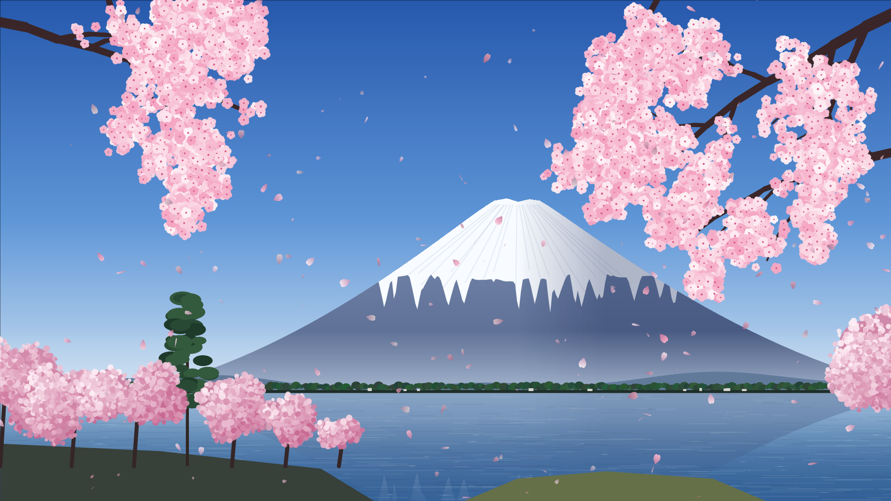
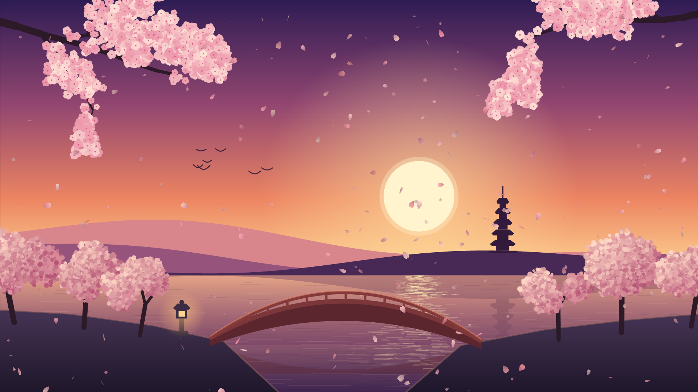
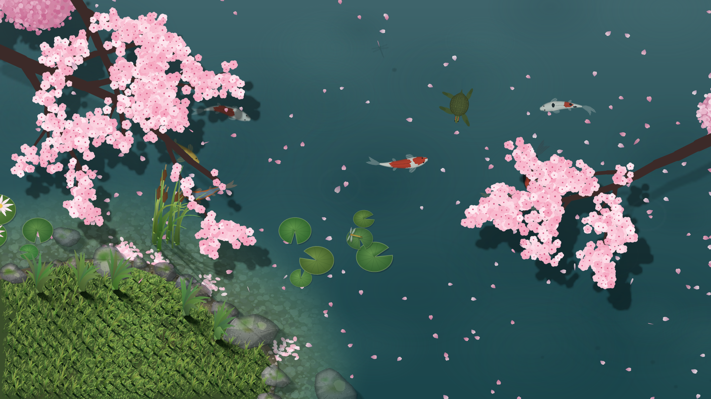
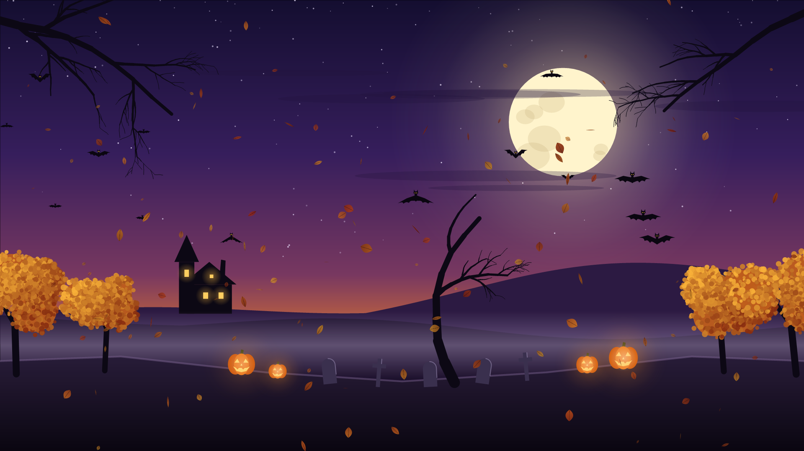
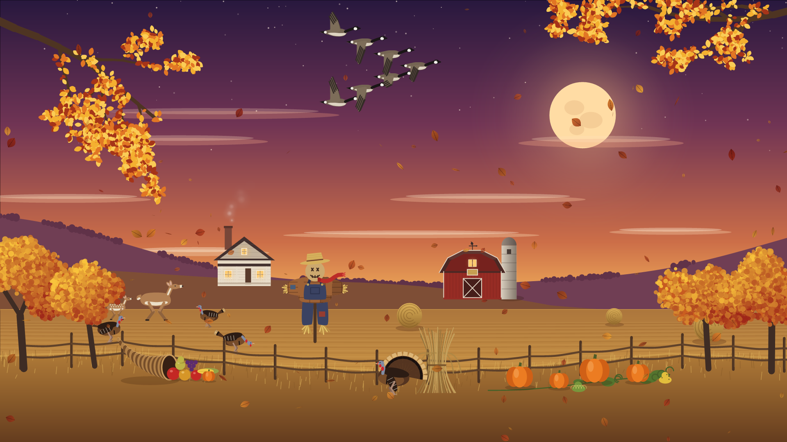
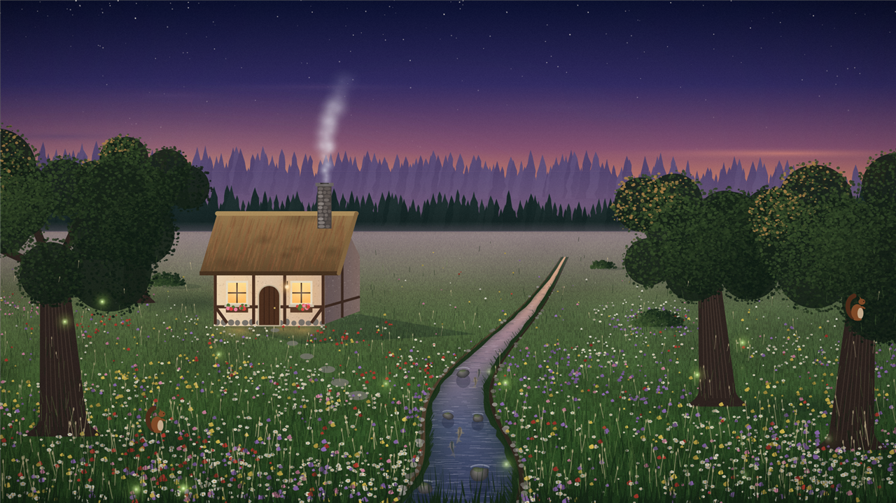

# Peckworks Screensavers

Native Windows screensavers written in C# (.NET 10, Windows Forms), plus a small reusable engine
for making more of them. So far: **Matrix Rain**, **Sakura**, **Sakura Dusk**, **Sakura Pond**,
**Halloween**, **Christmas**, **Thanksgiving** and **Cabin by Stream**.

## Matrix Rain

A close replica of the "digital rain" from *The Matrix* (1999): mirrored half-width katakana,
near-white flickering leading characters, fading green tails, characters that mutate in place,
drops at varied speeds and brightness, and a soft phosphor glow.


Settings: speed, density, character size, glow.

## Sakura

White and pink cherry blossom petals drifting down like snow over a painted scene of Mount Fuji
across a lake, framed by branches in full bloom. Stylized rather than photorealistic.



- Petals tumble, spin, sway, and ride a breeze that rises and settles.
- Depth: near petals are bigger, faster, and more opaque than far ones.
- Some petals let go of the blossoms on the branches; light glints on the lake.
- Trees stand on two banks of land in front of the lake, with a pine behind the grove.
- A small wooden boat with a roofed cabin, a boatman in a straw hat and a red lantern drifts
  slowly across the lake, passing behind the banks and trees.
- Branches and trees are grown randomly, so each run looks a little different.
- Twenty small **happenings** come and go at random, one every 5 to 12 seconds:

  | Where | What happens |
  |-------|--------------|
  | Fuji and the sky | A lens-shaped cap cloud (kasa-gumo) forms on the summit. The mountain blushes red, like Hokusai's Red Fuji. The sun crests the summit and blazes into a "Diamond Fuji". Origami paper cranes glide past. A painted kite dances on its string. A rainbow arcs over the lake. Cloud shadows drift across the mountain and the water. |
  | The far shore and the lake | A shinkansen races along the far shore. A sun shower glitters down and dimples the lake. A raft of fallen petals (hanaikada) drifts by. A mother duck leads her ducklings across. A kingfisher dives for a fish. Swallows skim the water. |
  | The banks | A heron stands in the shallows and strikes. A Shiba Inu trots along the hill, sits and smiles. Butterflies dance around the blossom trees. |
  | The branches | A pair of white-eyes (mejiro) visits the blossoms. A squirrel scampers along a branch. A glass wind chime (furin) swings and rings. |
  | Everywhere | A gust tears a blizzard of petals (hanafubuki) off the branches and sweeps it past you. |

Settings: number of petals, fall speed, breeze, petal size, and how often a surprise happens
(0 turns them off).

## Sakura Dusk

The same slowly falling petals over a different painting: a pond at sunset, with a low sun
setting behind hazy hills, a pagoda on the far shore, an arched wooden footbridge, a stone
lantern with a glowing window, and cherry trees on both banks. A small flock of birds flaps
slowly across the sky, each bird on its own rhythm, gliding now and then.



- Petals are tinted by the evening light, and golden glints twinkle in the sun's reflection.
- The nearest hills, the pagoda, and the bridge are mirrored faintly in the still water.
- The same boat as Sakura's, here a small silhouette far out near the opposite shore.
- Twenty happenings of its own, none shared with Sakura:

  | Where | What happens |
  |-------|--------------|
  | The sky and the sun | The sun's top edge flashes green. Rays of light fan up from the sun. The first star of evening appears and twinkles, then others. A crescent moon sinks behind the hills. Golden clouds drift by. The light deepens into a richer "magic hour". A crane flies across the face of the sun. |
  | The hills | A procession of fox lights (kitsune-bi) winds along the hills. |
  | The pond | Paper lanterns float across the water (toro nagashi). Koi glide under the surface. A lotus opens. Mist gathers over the water. A breeze ripples across the pond. A frog leaps in, as in Basho's haiku. |
  | The bridge and the banks | A cat crosses the bridge and sits to watch the sunset. Red paper lanterns light up along the rail. A tanuki waddles along the bank and tries to catch a petal. The cherry trees light up from below (yozakura). |
  | The air | Fireflies rise from the banks. Red dragonflies dart over the pond. |
- The same settings as Sakura (petals, fall speed, breeze, petal size, surprises), saved separately.

Sakura and Sakura Dusk share one petal engine and one set of painting brushes (banks, trunks,
blossoms, branches) in the Core project, so they have the same illustrative hand.

## Sakura Pond

A koi pond seen from above, the way you see one leaning on the rail of a bridge. The pond is
bigger than the view: still water fills the screen under cherry branches in full bloom, and the
only shore in sight is a corner of lawn at the bottom (left or right, the seed decides). Rocks
of every size sit along the water's edge, each with a sunny face, a shaded face, moss and lichen,
a dark wet flank just inside the rim where the water meets each one and a dark thread in the
water round its foot, so the water goes round every stone and stops at the ground (a stone on the
bank is never tinted along the bank's own curve); between the stones the water LAPS at a strip of
sand and pebbles, a swell travelling along the bank that runs up the sand a finger's width with a
thread of foam at its edge and drains back slowly, leaving a dark wet band that dries in a few
seconds, climbs the foot of each stone the same way, and washes further up when a ring on the
water (a koi's gulp, a frog's splash) reaches the bank; a lizard or a mouse drinking at the edge
backs off when a swell reaches its nose; clumps of iris leaves stand on the lawn behind the
stones, arching out over them toward the water; a clump of cattails stands in the shallows, brown
heads nodding; lily pads and water lilies float in the calm water nearby, each on its own stalk
like a balloon on a string: a fish, a turtle, the snake or a duck that swims into one shoves it
aside a little and it eases back over its root, and a pad with a frog or a dragonfly on it stays
put; and the branches throw dappled shadows on the water. The pond bed is ground with a shape:
humps and hollows lit on the side that faces the sun and shaded on the other, seen through water
that darkens with depth but never hides the bottom; the island and the rock formations are
boulders standing on it, each a smooth mound lit the same way, a solid grey stone going down into
the murk the way a deep fish does, darker and bluer the deeper it goes. The lawn is a meadow corner in a breeze, different on every seed:
lush and sun-baked patches, a worn spot or two where the earth shows, drifts of clover and
velvety moss, tufts of grass in three heights and three greens with dry tawny ones among them,
taller grass gone to seed along the edges, and drifts of wildflowers (daisies, buttercups,
dandelions and their seed clocks) that nod on their stalks. A gust crosses it as a soft, patchy
sheen of pale bent blades, each gust its own shape, and the tufts lean over and spring back as it
reaches them. There is ONE wind: the lawn, the tufts, the flowers, the cattails, the irises and
the falling petals all read the same gust at the same moment, so a gust crosses the scene as one
travelling wave (the cattails and irises sway with it stiffly; each iris leaf shows a lit half, a
shaded half and a pale midrib, the way a sword leaf folds). The cherry boughs sway in it too, the
tips swinging and settling like springs while the thick wood near the trunks barely moves, and the
petals in the air follow the eddies: a petal curves one way, then the other, spins faster in a gust
and drifts in a lull, so no two fall the same way.



- **Koi** of eight real varieties (kohaku, sanke, showa, yamabuki ogon, chagoi, asagi, tancho,
  plain red-orange) cruise the whole pond: a few tail beats, then a long glide. Each body bends
  through its turns along the path its head swam, never flipped or slid. They swim at real depths:
  the pond has a bed that slopes up to the bank and to every rock, a fish is never deeper than
  the water under any part of its body and rises up the slope before the shallows (and keeps off
  a stone's shoulders, where the water would be under half the pond's depth; since round thirty-nine it feels those shoulders coming by a room grid of its
  own, so it turns before a stone instead of nosing against it, creeps up a stone's flank instead of freezing
  on it a frame at a time, and lets its tail go quiet when it is held; since round forty-three that grid is
  stacked by depth, so every slope of the bed and every mound is felt the same way, at the depth the fish is
  at). The fish has a HEIGHT
  (a carp's body is about three tenths of its length deep, a goldfish a little more), and the bed
  rises gently to the bank over a third of the screen's unit, so a fish heading for the shore swims up
  the slope, then its back and dorsal fin break the surface (drawn clear of the water's haze, with a
  dark ridge and a wet gleam) and it ploughs a real V of bow waves, and where the water is under
  three quarters of its height it can go no further: that is the shore to it, as to the turtle. Now
  and then a koi goes up the slope on purpose (a visit to the shallows, a few seconds nosing in the
  sand with its back out, then away). And the open pond's bed is not one depth: humps and hollows
  take it a fifth either way of its usual depth, so the fish on the bottom are deeper in some places
  than others. THE BED IS A CARPET OF THINGS, not a painted floor (round forty-four, from photographs of real pond
  bottoms): olive silt with a fine grain, gravel bars of fist-sized stones each lit on top and shaded under, filmed
  with algae, a heap of rubble round the foot of every boulder, last year's leaves lying flat in five browns, the
  odd dark twig, and soft patches of algae; and the water itself is a pond's green, olive in the shallows to bottle
  green in the deep, not a swimming pool's teal. A
  deep fish
  sits lower on the screen than the water above it (we look at the pond at a slant) and comes up
  the screen as it rises, and in the shallows it throws a shadow on the bed, a soft echo right
  under it that fades as it rises off the bed (never thrown far: a shadow a body length away
  reads as a fish hovering above the water). A deep fish is
  smaller, softer, darker and duller than one at the top (water eats the warm light first, so a
  red koi on the bed is a dull brown-red and a white one a pale blue-grey, both still plainly
  fish: the water's own haze over them is slight), so when one passes over another you
  can tell from above which is over which, and the near one leaves a soft dark echo of itself
  on the deeper one's back where they overlap. They slip under the lily pads, and now and then
  come up to gulp at the surface, leaving a ring. A fish swimming with its back at the surface
  pushes a small bow wave ahead of its nose, a thin V of faint ripples trailing behind it (the
  turtle, the snake and a swimming frog leave one too): the one thing in a calm pond that says
  where the surface is, so the topmost fish read as just under it, not lying on it. Even at the
  top a fish takes a little of the water's colour. The pond is deep enough to hide a fish: the
  fish swim at any depth the bed allows, go smaller and hazier the deeper they are, and then out
  of sight; the deeper, the dimmer its own colours (darker and greyer) while the water over it veils
  it a shade less than it did. They steer over, under and round each other in three dimensions, and if two do touch
  they bump (a short recoil, then a shy swim away) rather than pass through. The 3D navigation
  kit behind this lives in the engine (`Core/Minds/Space.cs`) for other savers to use. A diving
  fish tilts: every point of its body is as deep as its head was when it passed there, so the
  head goes smaller, hazier and lower on the screen before the tail does, and a fish diving out
  of sight goes head first, tail last; one hanging still levels out. Hovering, its side fins
  scull by turns, one sweeping back as the other comes forward, the slow treading that holds a
  koi in place; swimming, they beat together. The sun gleams along its back, down the backbone
  when it heads toward or away from the sun and out on the sunward flank as it turns across the
  light, brightest on the metallic varieties and fading with depth. Nothing in the pond passes
  through a floating petal: whatever has its back up at the surface (a koi gulping or brushing
  it, a paddling turtle, the snake) shoves the petals in its way aside, and they glide off and
  slow; a fish swimming under them leaves them be.
- **An island rock** stands out in the open water: a boulder on a mound of the bed, darker and
  bluer down its side until the shoal round it takes over (never see-through: it covers the bed), with a small dry cap breaking the surface:
  the cap's rim is wet, the stone just under the surface round it is a lit grey shoulder,
  and the stone is drawn sunk by its depth the way every fish is, so the dry top is the top of the
  same boulder and nothing swims between them; a fish deep behind the cap is hidden by it. Two
  small rock formations stand in the water as well, one toward the lower left and one toward the
  upper right, each a stone going under with two or three little dry caps. The pond is a little
  deeper than it was (and a tiny bit more again), and its bed is uneven: broad humps and hollows that the water's colour, the
  bed's clearness and every swimmer's depth all follow. Anything that swims deep loses its colour
  with the depth, darker and greyer the further down it is, before the water's own colour veils it.
  The koi swim up and over its shoulders and round the cap, and the water is clear enough now
  that the bed and its stones show through the deepest part.
  The turtle rows as a pond slider does (the diagonal pairs together, a long push, a folded leg
  on the way forward) and coasts between bouts; the koi, the goldfish and the turtle go down to
  the bed to forage and dive far more often. Once in a while one rises slowly until its back brushes the
  surface from below, and three thin, slow rings slip off it as it glides on.
- **Goldfish** (three by default, a "Goldfish" knob from 0 to 6) share the pond with the koi: a short, deep-bodied
  wakin under half a koi's length, orange-red, red and white, or a pale calico, trailing a long see-through forked tail
  that flutters behind it. It is the same fish in the same water (same body, steering, depth and bump rules), but it keeps to
  the sunlit top of the pond, beats quicker, nibbles at the surface twice as often, flinches from a swallow's shadow from further
  off, follows other goldfish far more readily than a koi, never chases a koi, and idles in the neighbourhood of a shoalmate,
  so three of them drift about as a loose little shoal. Now and then one DARTS: two to four quick zig-zag bursts near the
  top, the way a goldfish in a bowl does, and pairs of them chase each other twice as readily as the koi do; and every
  goldfish keeps a little under the surface with a touch more of the water's haze on it, so it never looks to be
  sitting on top of the water. Every fish's idle drift reaches deeper than it did.
- **A catfish** (one by default, a "Catfish" knob from 0 to 3; round forty-four) lives on the deep bed: a bullhead
  as long as a koi, broad and flat with a wide head, dark olive mottled with darker blotches and paler patches, four
  whiskers that sway as it swims, and no bright colour anywhere. It is the koi's body and mind a third time, with a
  bottom fish's nature: it starts deep and asks for no depth shallower than three quarters of the pond's, never
  gulps at the surface or leaps, never comes up to look at a petal or to visit the shallows, follows and chases no
  one, and cruises slowly along the bottom (half a koi's pace), foraging in the silt more than any koi and resting on
  the bed for long spells. Its feelers see as wall only what it can never ride over (bed under six tenths of the
  depth: the bank's slope and the boulders), and it never answers a wall with a climb; the bumps and the mounds'
  skirts it follows with the bed. Its dice are its own, so the knob moves no other fish.
- **Each koi has a mind of its own.** Three personality dials are dealt when it is born (spread
  across the school, so near-twins are rare): how
  energetic it is (how much it beats rather than glides, how fast it cruises), how sociable, and
  how curious. From those it decides, one thing at a time, what to do next: wander, rest deep and
  still, go down and forage along the deep bed (half a minute of slow cruising from one deep spot
  to the next, a pause at each with its nose in the silt and a puff of it rising, a hazy shape
  doing something down where the pond is darkest), go and nose at something (a floating petal, which it may gulp down, the rim of a lily
  pad, the foot of the cattails, the side of the floating log, or the spot where a dragonfly just
  tapped the water), swim along behind and beside a friend, or now and then burst after another
  fish, which speeds up and swerves away until the chaser loses interest. Only one chase runs in
  the pond at a time, and a curious fish answers a dragonfly's tap far more often than a dull one.
  Each koi also keeps a liking for every other fish: it starts from how alike their dials are, grows while
  the two spend time close (faster when one follows the other) and fades with a half-life of twelve minutes
  when they are apart, so pairs and trios form and drift over an afternoon. A fish with a friend follows it
  far more often, for a minute or two instead of ten to thirty seconds, keeps pace with it, idles toward the
  friend's destination and rests beside it. Two fish may follow each other, each keeping its slot beside and
  behind the other, which is how a pair keeps station for half a minute or more; never more than three keep
  company, and the bump and shy rules are unchanged.
  When a swallow skims low over a fish, its shadow makes the fish dart away and dive, and it sulks
  deep for a while; a bold fish (energetic and sociable) barely notices, a timid one flinches at a
  shadow some way off. And now and then a koi LEAPS: a burst up from an unhurried cruise, half a
  second clear of the water (it rises up the screen with its shadow left on the water, the way
  a falling petal or a perched turtle shows its height), a splash of rings and flung drops, and
  the fish nearby flinch from it; then it dives to get over itself. About one a minute or two
  somewhere in the pond, more from an energetic fish, never from a goldfish. Once in a few minutes a big koi
  near a school of minnows, with the school ahead of its nose, TEASES it: a real dash of about a second at the
  school (half as fast again as any other rush), and as its head reaches them the school EXPLODES, every minnow
  bolting straight away from the head so the shoal bursts into a ring, then gathers itself again a little way
  off and drifts on; the koi glides to a stop, turns slowly away and rests or wanders on;
  it never catches or eats anything, and only one fish plays at a time. The lizards and the snake think
  the same way, on the same shared parts
  (`Core/Minds`); how to give any animal in any saver a mind is [docs/MINDS.md](docs/MINDS.md).
- Two **schools of minnows**, a dozen or so tiny fish each, hang just under the surface and move
  as one: all facing the same way, fidgeting in little darts, flashing silver when the whole
  school turns, and scattering like thrown rice when a koi cruises underneath. Each minnow is a
  bending body on its own trail, like the koi in miniature. A minnow that meets the island, the log
  or a bank rock between it and its school turns and swims along the stone to get round it (its
  tail only beats when it is actually moving), instead of nosing the rock. About one drift in sixteen is a
  DIP: the school swims briskly down to a spot on the deep bed (half the time near one of the deep dwellers
  below), sinking no faster than its swim can hide, grazes there ten to twenty-five seconds (drawn under every
  koi, hazed and shrunk by its depth) and comes up on its next drift.
- **The dragonfly's game**: every so often a dragonfly flies over to a school, hovers, then skims
  low and taps the water three times in a short line, each tap a small ring. The minnows rush to
  the rings in a body and circle under the spot, nipping at the surface where the dragonfly
  touched (a fizz of tiny rings). The dragonfly darts off across the pond, wanders, and comes back
  a little later to do it again, taking the schools in turn.
- A **turtle** (a red-eared slider, the turtle of nearly every park pond in Japan: an olive-green
  shell with pale seams between the plates, an olive head with thin yellow lines and the red patch
  behind each eye, and legs with webbed, clawed FEET, not a sea turtle's flippers) paddles just
  under the surface, front left leg with back right and then the other pair, with a small surge
  on each stroke, the toes spreading on the push, turning as one rigid piece in wide slow arcs, its head leading each turn on
  its neck. It steers in three dimensions like the koi: its feelers take it over, under or round
  a fish in its way, and where the two still meet (about ten times in three minutes) the fish is
  pushed out of it; its rise and sink while it paddles are held to what the paddling can hide,
  so it never slides up or down the screen. Now and then it stops, spreads
  its legs and floats up (a buoyant rise at one slow rate whichever way it faces: it grows and
  sharpens as it comes, which reads as surfacing), pokes its nose up for a breath (one small ring), drifts over to a petal
  and nibbles it, then paddles off, or
  dives to the bed for a while. A tadpole it comes upon while cruising or diving it may chase, half again
  as fast, and eat if its nose gets there. And it hauls out: it swims up to the island rock or the fallen
  log, climbs onto it, sits with its legs spread in the sun for fifteen seconds to a minute, and
  slips back in (sooner if the snake comes near, and then on the side away from it). Each turtle has its own dials: how much it loves the sun
  and how jumpy it is.
- **Frogs** (tonosama-gaeru, the Japanese pond frog) sit on the lily pads, the dry bank rocks and
  the bank's edge, olive green with brown blotches and a pale line down the back, two bulging
  eyes on top of the head. One of them is the grown frog; any others are young ones, two thirds
  its size, that croak only now and then. A frog sits still for half a minute at a time, its pale throat
  fluttering and now and then swelling in a croak (no sound), with the odd shuffle or hop round
  on the spot to face the water; a bold one snaps at a dragonfly that settles close, or at a froglet (or
  a tadpole up near the top) that comes within a snap of its perch, and eats it if the snout lands on it. Then it
  leaps: a crouch that gathers the legs in under it, the spring with the hind legs straight out
  behind, an arc a few body lengths long with its shadow left behind on the pad and then the water
  (the gap is the height), a splash, and a skim into the water with the legs still out, slowing,
  until the first kick. It swims with real frog kicks (the thrust that surges the body, a glide
  with the legs stretched out behind, then the legs drawn forward for the next; it steers in the
  kick; the arms stay tucked along its sides), floats with its legs hanging and its arms spread,
  treading water with a lazy half-kick now and then, steers round pads and the bank, and climbs
  out onto another pad or the bank with a short hop, settles, and turns to face the water in a
  hop or two. Frightened by any part of the snake, a koi's head, a turtle, a duck, a lizard or a
  swallow's shadow, a sitting frog leaps in and a swimming one dives (hazy and smaller as it goes
  down, back up with a tiny ring, and never up under the snake or a duck). A frog in the water is
  solid to the koi (they steer round it and a fish that meets it is pushed out), is pushed clear of
  the snake, the turtles and the ducks, and shoves the floating petals aside. Each frog has its
  own two dials: how bold and how restless. A frog in the water is IN it: only its head is clear
  of the surface, its back, rump, legs and arms are under the water's haze and go darker and
  greyer for it; its kick is a whip (the feet sweep out wide and close as the legs straighten) and
  each thrust leaves a small ring from each foot; a landing is a real splash (a big ring, foam,
  drops flung up that fall back with rings of their own). Frogs live on the bank and visit the
  water: a trip in lasts a dozen seconds or so, to the next pad or stone, not across the pond.
- **Tadpoles** hang in a loose cluster over the bed in the warm shallows near the cattails, tails
  sculling lazily, some grazing at a rock's flank, the bank or a pad's rim. Now and then one bursts
  (curls into a C, whips its tail and shoots a few body lengths, then stops dead); anything big
  coming near scatters them and they drift back together. One at a time, minutes apart, one grows
  up: buds, hind legs, forelegs, the tail shrinking, then a froglet that rises, swims off with frog
  kicks across open water (shoving petals aside) and leaves the screen for good. When the cluster
  has thinned, a new hatch of tiny ones appears at the cattails or a pad's rim. The cluster does not
  stay in one spot: every two to five minutes it drifts, as a loose cloud at a lazy pace, to another
  haunt (the shore shallows half the time, the island's shoulders a third, the outer shallows the
  rest; the way to the island is across water too deep to see the bed, which they cross in the
  sunlit upper water, so the koi may well find them there), and about once a minute one tadpole
  ventures off on its own, a few bursts out to a spot 0.1 to 0.2 of the screen away, a pause or a
  graze, and back. The knob "Tadpole
  clutches" (0 to 3, default 1) sets how many clusters. Tadpoles are too small to be solid to
  anything: they pass under fish and pads and flee them; a froglet at the surface is solid to petals.
  Everything under the water (tadpoles, a rising froglet, koi, minnows) is painted under the floating
  petals and under the heap of petals drifted against the bank. And they are food: an animal that
  happens to come near the clutch and sees them (a koi, a turtle, a frog on its pad, the snake, a duck,
  the crayfish) will sometimes single one out, chase it for a few seconds and eat it, or lose it; nothing
  goes looking for them, and each animal rests for minutes between tries. A thinned clutch hatches more.
- A **crayfish** (amerika-zarigani, the red swamp crayfish of every Japanese ditch) lives under a
  bank rock or the log and now and then comes out into the shallows where the bed shows: it edges
  out claws first, walks slowly on eight legs rippling in a wave, antennae waving, stops to feed
  (a claw reaching to the mouth over and over), puts both claws up in a threat, backs up a little,
  and, when a koi or a turtle passes over, escapes with the tail flip: the abdomen snaps under and
  it shoots backward two or three times, then sits with its claws up and walks home and slides
  back under the stone. It is drawn on the bed (sunk, hazed and shrunk like the fish above it)
  and is solid to nothing: everything swims over it. A tadpole within a few steps on the bed it walks
  at, briskly, and eats if its claws reach it; then it stands and feeds. Each visit has its own two dials, how bold
  and how hungry. The "Crayfish" knob sets how often it comes out (0 for never).
- A few **freshwater prawns** (the sujiebi, the see-through striped shrimp of a Japanese pond; the "Prawns"
  knob sets how many, three by default) live on the bed of the shallows near the stones that stand in
  the water. Each is about two thirds the length of the crayfish, nearly transparent with a faint
  grey-green cast so the bed shows through it, with a dark thread of a gut down its back, a few thin
  oblique stripes on its tail segments, two eyes on stalks, and two antennae twice its length that are
  never quite still. It stands and picks at the silt with its front legs for ten to forty seconds,
  walks a few body lengths on five pairs of legs rippling in a wave, now and then lifts off the bed and
  swims forward slowly before settling again, and, when a koi, a turtle or a duck comes near, escapes
  backward with two to four tail flips (the abdomen snaps under, a quarter second apart), sits still
  with its feelers up, and walks back toward home. It is drawn on the bed (sunk, hazed and shrunk like
  the fish above it), is solid to nothing, and each has its own two dials, how bold and how busy.
  A koi that is at least half hungry, or the turtle when it has not eaten for ten minutes, may spot a prawn within
  reach and go for it (the same chance meal as a tadpole); the prawn flicks away as it would from any fish, most
  chases end in a miss, and a prawn that is taken is back at its home from under the stones a few minutes later.
- A few **pond snails** (tanishi, the river snail of a Japanese pond; the "Snails" knob, four by default, 0 for none)
  creep over the bed: a coiled brown shell about a hundredth of the screen across with a paler whorl line winding
  round it, a soft grey-tan foot showing ahead of it with two short tentacles that wave as it goes. A snail's pace
  is a body length every twelve seconds, with stops of ten to forty seconds to graze, so one is noticed only by
  someone who looks, and then it is seen to be moving. It rides the bed (its depth is the bed's under it, so it
  climbs a submerged stone's mound and comes down the far side, drawn sunk, hazed and shrunk by that depth like
  everything else down there), turns at the land, a standing rock or a pad's foot, and is solid to nothing: every
  fish and every bed animal passes over it, and nothing eats it yet. On the deep bed, among the leaves and the
  cobbles, lie a fish skeleton or two (skull, vertebrae, swept-back ribs, a fanned tail, in old bone), what the
  catfish and the eel leave behind: painted into the bed once, like the rest of its litter.
- **The deep dwellers** (the "Deep dwellers" knob, four by default: every third from the first a crayfish, the
  rest prawns) live on the bottom of the deepest water, where the pond's haze leaves them about four tenths of
  their own colour: barely visible, on purpose. The crayfish is a signal crayfish (uchida-zarigani): brown-olive,
  bigger than the red one of the shallows, with a chalk-white patch at the hinge of each claw. The prawns are
  oriental river prawns (tenagaebi, "long-armed prawns"): see-through olive-brown with dark freckles, half again
  the sujiebi's size, with their second pair of legs grown into two thin arms longer than the body, each ending
  in a small pincer. They forage (standing, picking at the silt, a crayfish bringing a claw to its mouth), skitter
  in short brisk walks between stops, raise their claws at a fish that comes over or flick backward from it, and
  now and then two of them fight: they face off, lift and spread their claws with the feelers whipping, close until
  the claws touch, lock and shove to and fro with the stronger gaining ground, and the loser flips away while the
  winner stands tall. A school of minnows that dips to the bed near one can lose a fish to it: the near claw shoots
  out and snaps, and a hit is held in the pincer and eaten over a quarter of a minute (the school bursts away from
  the claw either way). And they are food themselves: one of the largest koi, hungry and already down on the bed,
  a hungry turtle on a dive, or the snake when it dives may single one out and take it, and a newcomer of its kind
  walks in from beyond the picture's edge a few minutes later. Each has its own two dials, how bold and how busy;
  they are solid to nothing and pass under everything.
- **Ducks** (off by default for now; the "Ducks" setting brings them back) swim by now and then: usually a mother with three to six ducklings, sometimes a drake and
  a hen, sometimes a lone drake, of one of four species (the eastern spot-billed duck, mallard,
  mandarin, common teal), each with its own colours seen from above (the mandarin drake's two
  orange sails, the mallard drake's green head and white neck ring). A duck comes in from beyond one
  edge over water, crosses by a few stops in open water, and leaves beyond another, in a minute or
  two. It paddles with its head rocking in time and a V of rings off its breast, looks about (the
  head turns, the body does not), dabbles (tips up, head under, tail clear of the water), preens
  (head back over the shoulder), flaps (the wings open from the shoulders, flung wide three times, a little spray, a tail wag),
  and stops and looks back for a straggler. The ducklings follow her trail in a line (two abreast
  when there are many), each pointing a body length ahead of its own place on her trail and
  matching her pace with a gentle closing on the gap, never more than a third faster than her
  cruise (each sways a degree or so with the paddle, once every 0.7 s or so: a fast four degree
  wag read as the ducklings shaking), and now and then one of them does something cute, never two at once: one
  lags to peck at something and scrambles to catch up, two bump and spin, one pecks a petal, one
  dabbles where the minnows flash, all dabble bottoms
  up, all bunch under her chin, or she flaps and they scatter and come back. If the snake comes near
  she herds them away. Every duck and duckling is solid to the koi, shoves the floating petals
  aside, and is a head the minnows, tadpoles and frogs keep clear of; a duck goes round the turtle,
  the snake's body and a swimming frog, the snake swims round the ducks and is startled by a touch
  from one, a swimming frog dives from any part of a duck, a duck that the snake, a frog or a
  surfacing turtle still gets onto recoils off it, and the two adults of a pair keep off each
  other. A grown duck paddling past the tadpoles' shallows may, rarely, single out a tadpole or froglet near
  its bill, swing round at it a third faster than a cruise and tip down for it with its neck stretched
  forward (eaten only if the bill gets there; a duck never goes looking for them, and not again for minutes).
  What may still overlap for a few seconds: a frog and the snake, a frog and the turtle, the
  snake and the turtle (none of them moves for the other), a duckling and a floating frog. The "Ducks" setting scales
  how often they come (100% is every four to eight minutes).
- **Petals** let go of the blossom, sway and tumble down, their shadows sliding in to meet them,
  touch the water with a tiny ring, then float, drifting slowly and gathering against the banks.
- **Dragonflies** (shiokara tombo, the pale blue dragonfly of Japanese ponds) hover, dart and stop
  dead, perch on lily pads, and the golden female dips to touch her tail to the water.
- **An old sunken log** on the deep bed, its bark still on: dark ridges running along the trunk, broken and
  wandering, cross cracks, a patch or two where the bark has fallen off and the paler wood shows, a knot, and at
  the near end the sawn face with its growth rings round the black hollow. It is part of the bed itself (the fish
  rise over it, the shadows fall on it, a stone in front hides it), and the hollow is the first deep dweller's den,
  so a crayfish is usually found at its mouth. The hollow is lit the way the sun would light it: the inner wall away
  from the sun catches it, the rest falls to black.
- **An eel in the log** (the "Eel" knob, 1 by default, 0 for none): a Japanese freshwater eel lives inside the hollow,
  lying with its head at the mouth, its gills working, withdrawing when a koi or the turtle passes over the door. Now
  and then it peeks further out, looks about, and slides out head first to forage in an S along the deep bed with its
  nose in the silt; a prawn or a minnow of a dipped school within a head's length gets a sideways snap. Then it swims
  back to the mouth, turns its tail to the hole and backs in, the body sliding into the dark until only the head shows.
  Alarmed in the open it flees for the hollow in a fast tight S. It is drawn inside the log by the pond's own depth
  test: what is under the wood is hidden, what reaches past the cut face shows.
  A rock in the water is a rock: the water meets its edge, and below it a short shaded foot of its own side shows
  through the water, the light net playing on it. A petal that floats up to a lily pad is held at its rim, and one that lands on a pad stays.
- **Sunlight and the surface** (the "Sunlight" knob, 100 percent by default, 0 for none): what a sunlit pond shows from
  above. A CAUSTIC NET on the bed: the ripples are lenses, and they focus the sun into bright branching lines, a net of
  cells that slides and merges all the time, sharp in the shallows, faint on the deep bed, gone in the boughs' shade,
  under everything that swims. A SHIMMER: everything under the surface is seen through the ripples, so the bed, the
  stones and the log sway by a pixel or two at a ripple's pace, which is what says there is water between you and the
  bottom. SPARKLES on the net itself: where the lines of the net cross, the surface flashes white for a moment, and
  the flashes come and go as the net slides, which is what the little flashes on a real pond are (the sun caught on
  one small wave, in the one spot your eye happened to be). Nothing drifts and nothing piles up. The open sun is a
  little brighter than the shade under the boughs, so the flashes belong to the day they are in, and the whole day, sun
  and shade alike, is a shade brighter again (round forty-seven). And every swimmer that breaks the surface (a turtle paddling with its shell awash, the snake, a koi with
  its back out) leaves a V-shaped bow wake, the cross waves held inside the wedge behind it. Light is solid to nothing.
  (The beams and the bed pools of 2026-10-30 were taken out on 2026-11-02: seen from above the water they moved the
  picture by under two grey levels, and what read as "light rays" was the bed's own slope lighting.)
- **Swallows** visit to drink: low, fast, sweeping curves with bursts of wingbeats and swept-back
  glides, skimming the surface with a line of rings, their shadows racing below them.
- Now and then a **snake** (one of four Japanese kinds, a different one each visit: the shimahebi,
  olive with four dark stripes; the aodaisho, olive green with soft darker blotches and a pale head;
  the hibakari, plain brown with a cream line along the neck; the karasuhebi, near black with a blue
  sheen down the back; drawn with a real head and neck, a rounded body lit in rows of scales, soft-edged
  marks, and only the head riding clear of the water) comes out of the grass, swims across the pond with its body weaving behind its head and a
  small wake, and slips away. It is
  not on rails: it feels its way, goes round the lily pads, the rocks, the log, the island's cap, the cattails and
  the iris clumps rather than over them, pushes the floating petals out of its way, and if a
  koi, a turtle or the lizard touches it, it startles: a burst of speed, a swing away, rings off its head, then it calms. Half of
  its swims about the pond are dives: it goes down head first to a third to seven tenths of the pond, the body following, drawn
  smaller and hazier under the fish, and comes up again before it hunts or basks. Down there a stone's
  underwater hill is a wall to it as the bank is: it feels the hill coming and turns early and smoothly
  round it, never tighter than its body can follow, and its body is laid over the bed under every point of
  it, bending up a flank as a rope would, never through the stone and never stretched. A turn on the
  spot bends its neck, in the water and on the land alike (on the land the bend was refused and each
  turn was laid into the body as a corner that slid down it, round forty-seven); hemmed between two
  bank things with no room on any side it probes a ring of headings with the step's own test and
  crawls out between them instead of standing there. The koi and
  turtles treat its body as solid (they steer under or round it, and a fish that meets it is pushed out), and the minnows keep
  clear of it as they do of the koi. Each visit is a different snake: it rolls a boldness and a
  nerve, and then chooses what to do by weighted dice, a few things per visit. It may swim out
  to a spot in open water and then another (explore), creep up on a school of minnows and
  lunge at it with a ring off its head while the minnows scatter (hunt), or, when the log is
  afloat, swim to the log's end, climb on, lie along it for 10 to 30 seconds in a gentle S and
  slip off the far end (bask). A bold snake hunts and basks more and calms sooner; a nervous one
  just crosses, startles at a longer reach and stays frightened longer. It always ends by
  leaving across the far side. A snake that has gone in among the bank rocks or onto the lawn (after
  a prey, see below) comes out the way it went in: it remembers its path as crumbs and walks them back
  to open water before setting off for its next goal, so it never paces the pocket between the rocks
  and the picture's edge. And on the bank it HUNTS: a lizard or a mouse that comes face to face
  with it (within 0.14u, ahead of it, while it is on the bank or at the water's edge) may be
  stalked at a creep, then it draws its neck back into an S and strikes. Sometimes it lands: the
  prey thrashes in the jaws, goes in head first over a few seconds, and a lump the size of the
  meal travels down the snake and fades; sometimes the prey was already gone (a lizard flings
  itself aside, a mouse jumps straight up) and the jaws close on nothing. A snake strikes at most
  twice a visit, and one that has eaten is slow and would sooner bask. An eaten animal is replaced
  by a new one (new temper) two to five minutes later. A snake that is only swimming across, with a
  tadpole or froglet at the top of the water right at its nose, may single that one out for a few
  seconds' chase and a lunge (never looked for, and it rests four to eight minutes after any chase).
  The snake also gets HUNGRY: a dial from full to famished that rises over eight to fourteen minutes of
  pond time and drops with a meal (a lizard or mouse to nothing, a tadpole a fifth, a minnow an eighth).
  A hungry snake comes out sooner, goes to look at prey from further off and creeps up on a school of minnows
  and really lunges: about six in ten catch one (the school goes on one fish fewer, and a newcomer swims in from
  the picture's edge three to six minutes later), with a quick gulp, a small ring and no bulge. A famished one
  may strike three times in a visit; a full one does none of it.
- Two **lizards** (kanahebi, the Japanese grass lizard with the very long tail) each come out on
  the bank every couple of minutes: a dash, dead still, another dash, over the grass and up onto a
  rock to bask, its body and tail throwing an S-wave as it runs and its sprawling legs (a knee bent
  forward, five long clawed toes spread like a hand) stepping on opposite corners, then gone into
  the grass again. Each has its own temper, rolled once: a BOLD one stays
  out longer, basks longer and wins a standoff, an ENERGETIC one makes longer dashes with shorter
  rests. A lizard may run through the irises' leaves but never stops under them (the leaves are drawn
  over it, and one basking on a rock beside a clump showed as legs sticking out of the stone), so
  every rock it climbs, spot it runs to and place it drinks is out from under a bank plant. A dash
  begun facing the water turns on the spot first, then runs (on a bank stone's top every dash had
  taken its first step into the water and ended there).
  They also run to the water's edge and drink (one tiny ring in front of the nose), creep
  up on a dragonfly sitting on a bank rock (it takes off a body length short), bolt for cover
  when a swallow's shadow sweeps over them, and if
  both are out and meet, they square up nose to nose, then the bolder one charges and the other
  bolts away and leaves. If the snake comes close they run for the nearest edge, but only if
  they have SEEN it: one that was basking, drinking or facing away is caught up with, and some
  freeze instead of running. A strike that lands holds the lizard in the snake's jaws; one that
  misses makes it fling itself sideways in a single leap.
- A **field mouse** (akanezumi) lives in the bank's grass. It comes out at the screen's edge for
  half a minute or so, then goes: a plump brown oval with a round head, two pink-lined round ears,
  bead eyes, four tiny feet and a thin tail nearly as long as itself. It moves in scurries of a
  third of a second, tail streaming, and between them stops dead to sniff (the nose twitches), sit
  up on its haunches, groom (a quick shiver) or nibble with its head down. It keeps to cover: it
  prefers the grass and the foot of a rock or the log, crosses bare sand only when it must, now and
  then runs along the log, and goes to the water's edge for one tiny sip. It is prey: the snake's
  head, a lizard's nose or a swallow's shadow sends it bolting for the nearest grass, where it very
  often vanishes (a short fade) for 10 to 40 seconds and comes back out at the same spot. Each has
  two dials rolled once: a TIMID one flees sooner and from further, freezes more and leaves
  sooner; a GREEDY one stays longer, nibbles more and drinks more.
- A small **rock formation** stands out in the water toward the lower left, different every time:
  one small stone going under, painted and wrapped like the island's, with two or three little dry
  caps breaking the surface, each cap a rock to every animal (the fish rise up and over its
  shoulders and round the caps).
- A fallen **log** can lie at the lower left instead (the "Fallen log" setting, off by default),
  different every time: beached across the water's edge with one end in the grass and the other
  in the shallows when the land is in that corner, or drifting out on the water when it is not.
  Bark streaks, cracks, a knot or two, moss on top, and the cut end's rings where it faces us.

Settings: draw width (sharpness against smoothness), petals, number of koi (ten by default), number of goldfish (three by default), number of catfish (one by default), how playful the koi are (0 means they only cruise and rest),
number of minnow schools (0 means no game), number of turtles, number of frogs (two by default),
number of dragonflies, how often the swallows visit, how often the snake crosses, how many
lizards there are (0 to 3), how often the lizards come out (Lizard visits), how many field
mice live in the grass (0 to 3), how many clutches of tadpoles wriggle in the shallows (0 to 3,
one by default), how often the crayfish comes out from under its rock, how many crayfish and long-armed
prawns live on the deep bed (four by default), how many snails creep over the bed (four by default), and how
often a duck family swims by (never, by default).

On a screen wider than the "Draw width" setting (1920 pixels by default) it draws at that width
and Windows enlarges the picture: the scene is soft and painterly, so the enlarging loses little,
and fewer pixels is what keeps a steady 60 frames a second on a 4K laptop (2560 is sharper and
runs at an even 30 there). If a frame cannot be drawn and shown inside one screen refresh, the
engine holds an even 30 frames a second instead of juddering between 16 and 33 ms gaps. Since
2026-10-20 it holds 60 from the first second: every method is compiled at full strength before
the first frame (tiered JIT off, and a start-up pass that compiles the whole programme on a
helper thread), nothing is compiled or sorted on the frame an animal first appears, and the
ripples are painted on several cores. On the 4K laptop at the default width that is 298 of 300
on-screen frames at one refresh, where it was 153 before.

## Halloween

Autumn leaves in gold and red drifting down over a moonlit graveyard hill: a big full moon, a
haunted house with lit windows on the far hill, a dead tree, tombstones, a waving skeleton, autumn
trees, and bare branches clawing in from the top corners.



- Bats flap across the sky in three sizes, swooping as they go.
- The jack-o'-lanterns flicker like candles, and the skeleton waves.
- The leaves are the Sakura petal engine with a leaf outline, and they let go of the autumn trees.
- Nineteen small **happenings** come and go at random, one every 5 to 12 seconds, shuffled like a
  deck of cards so you see them all before any repeats:

  | Where | What happens |
  |-------|--------------|
  | The sky | Halloween fireworks (purple and orange, or green) burst and sparkle. A shooting star. A bolt of lightning. Stars join up into a constellation (a bat, a pumpkin, a ghost...). Three little ghosts float past in single file. |
  | The moon | The moon turns blood red. A witch on a broomstick flies across it. |
  | The far hill | The haunted house's windows flicker out and come back green. A cloud of bats pours out of its tower. Something huge with glowing eyes peeks over the hill. |
  | The graveyard | A ghost rises from a grave and says boo. A zombie hand claws up out of the ground. Will-o'-the-wisps drift among the stones. The skeleton's eyes glow red. A jack-o'-lantern changes its expression. A black cat trots through. |
  | The trees | A spider spins a web in the dead tree, strand by strand. Another lowers itself from a branch on a thread. Pairs of eyes open in the dark. |

Settings: number of leaves, fall speed, breeze, leaf size, number of bats, and how often a
surprise happens (0 turns them off).

Adding more happenings, here or to another screensaver, is a recipe:
[docs/ADDING_HAPPENINGS.md](docs/ADDING_HAPPENINGS.md).

## Christmas

Snow falling on a snowy night: pines strung with pastel lights that twinkle, a log cabin with
warm windows and a smoking chimney, snowy mountains, and a moon.


- Santa's sleigh crosses the sky, passing behind the overhanging branches, pulled by four
  galloping reindeer. Rudolph leads, and his red nose glows and sparkles.
- Every bulb (pink, mint, baby blue, lavender, butter, peach) brightens and dims on its own rhythm.
- The snow is the Sakura petal engine drawing soft white dots.
- Twenty small **happenings** come and go at random, as in Halloween:

  | Where | What happens |
  |-------|--------------|
  | The sky | A shooting star to wish on. The northern lights ripple. Stars join up into a snowflake, a star, a tree, a candy cane or a bell. Festive fireworks (gold and silver, red and green, or icy blue). A gust of wind whirls snow across. A drift of golden fairy dust swoops through. |
  | The moon | An ice halo with a faint rainbow forms around it. |
  | Santa | A present tumbles off the sleigh and lands in the snow. |
  | Far off | A toy train with lit windows crosses the valley. A reindeer stands on the mountain ridge. |
  | The snow | A fox trots through and stops to sniff. A rabbit hops by. A snowman builds itself and waves. A snowball rolls across, growing. A clump of snow slides off a pine. |
  | The cabin and the lights | Smoke rings (and a heart) from the chimney. A wave of brightness runs through every light. The star on the tree flares and showers sparkles. |
  | The corners | Frost crystals grow across a corner of the glass. A snowy owl perches on a branch and blinks. |

Settings: amount of snow, fall speed, breeze, flake size, and how often a surprise happens
(0 turns them off).

## Thanksgiving

Maple leaves drifting down over a farm at harvest dusk: a sky from plum to gold, a big peach harvest
moon, a white farmhouse with lamplit windows and a smoking chimney, a red barn and silo, a reaped field
with hay bales and a scarecrow, a split rail fence, a cornucopia spilling its fruit, a corn shock, a
pumpkin patch, maples in full colour, and oak branches with the year's last leaves in the top corners.



- A V of Canada geese crosses the sky, each goose on its own wingbeat, passing behind the corner
  branches.
- A flock of wild turkeys lives in the field behind the fence: they peck at the stubble, wander a
  few steps, stand and look about, and the tom fans his tail now and then.
- A white-tailed doe and her fawn graze at the far side of the field, lift their heads to look
  about, and move off a few steps at a time, the fawn trotting after her.
- Smoke drifts from the chimney, the windows' lamplight wanders, and the scarecrow's red scarf streams
  in the breeze.
- The leaves are the Sakura petal engine with a leaf outline, and they let go of the maples and the
  corner branches.
- Twenty small **happenings** come and go at random, as in Halloween and Christmas:

  | Where | What happens |
  |-------|--------------|
  | The sky | A shooting star. Stars join up into a turkey, a cornucopia, a maple leaf, a slice of pie or an acorn. Harvest fireworks. A gust whirls a swirl of leaves across. A hawk soars in slow circles. A giant parade balloon turkey drifts by. |
  | The farm | The porch light comes on and moths gather. Silhouettes pass the farmhouse windows, one carrying the bird to the table. A barn owl flies out of the loft. |
  | The field | An old tractor with a lit headlamp pulls a hay wagon along the lane. A doe and her fawn come up over the far ridge. |
  | The near ground | A wild turkey struts through, stops, fans its tail, gobbles and struts on. A squirrel bounds along the fence rail and sits up with an acorn. A crow lands on the scarecrow and caws. A raccoon raids the cornucopia and makes off with an apple. A pheasant bursts out of the corn shock. The scarecrow blinks and winks. |
  | The props | An apple rolls out of the cornucopia. Acorns patter down from the oak branch. A cardinal lands on a twig and sings. |

Settings: number of leaves, fall speed, breeze, leaf size, number of geese, number of turkeys in
the field, number of deer (a doe, a doe and fawn, or two does and a fawn), and how often a surprise
happens (0 turns them off).

Halloween, Christmas and Thanksgiving are built from the same shared pieces as the Sakura pair (the
falling engine, the ground, trees, hills and branches), plus one new one: sprites, small pictures
painted once and stamped each frame, which is how the bats, the sleigh, the geese and every moving
light (candles, bulbs, Rudolph's nose, the farmhouse windows) are drawn.

## Cabin by Stream

A flowery meadow at dusk, painted to look as much like a photograph as a painted scene can: a
small thatched cottage with lit windows and white smoke rising from its chimney, a stream winding
toward you with trout holding in the current, squirrels running between the trees and up them,
and fireflies blinking over the grass. The last of the sunset glows low on the left; the first
stars are out overhead; mist lies at the feet of the far forest.



- The grass is textured pixel by pixel (coarser near you, hazier far away), with thousands of
  small wildflowers in drifts, blades and seed heads in the near meadow, long soft shadows that all
  fall away from the glow, and a camera's vignette and grain over the whole picture.
- The smoke is a crowd of puffs that rise fast while hot, slow as they cool, spread, lean with the
  breeze and thin away.
- The trout face upstream, drift slowly back and dart forward to hold their place, seen through
  the water. Light slides down the stream's surface.
- Each squirrel follows a plan: sit, run to the next tree (sometimes stopping to sit up and look
  about), climb, sit on the trunk, come down head first, run back.
- Fireflies blink on their own slow cycles and are mirrored in the stream when they cross it. The
  windows and the door lamp flicker like firelight; the brighter stars twinkle.
- No happenings yet.

Settings: fireflies, number of fish, number of squirrels, chimney smoke, breeze.

## Retired: Cotswold Brook

A real photograph of Cotswold cottages by a brook, with ripples, trout, smoke, a falling dusk,
fireflies and mist animated over it. Retired: its fish were flat stickers that only faced left
or right, flipped to turn and slid about, swimming under a mirror-bright pond where no fish
could be seen. The code stays in `src/CotswoldBrook/` as a reference for what not to do; it is
no longer built. Its `RETIRED.md` says what went wrong and the rules that came out of it. The
engine pieces it pioneered (fitting a photo, day for night, fireflies, mist, and the depth map
that lets a moving thing pass behind nearer scenery) stay in `Core/Photo/` for photo savers to
come. `scripts\depthmap.py` makes a depth map with
[Depth Anything V2](https://github.com/DepthAnything/Depth-Anything-V2) (Small model, Apache 2.0).

## All screensavers

- Run on every monitor, at native resolution (4K included).
- Live preview in Windows' Screen Saver Settings.
- A settings dialog with its own live preview.
- Each is one self-contained `.scr` file. The PC does not need .NET installed.

## Install

```powershell
.\scripts\install.ps1                          # build all, copy to System32 (one admin prompt), open Screen Saver Settings
.\scripts\install.ps1 -Saver Sakura -Activate  # build and install one, and select it with a 5-minute wait
```

Then pick one in the Screen Saver Settings list. The install script closes any Screen Saver
Settings window that was already open (an open one keeps showing its old list), opens a fresh one,
and confirms the new screensaver actually appears in its list.

No-admin alternative: run `.\scripts\publish.ps1`, then right-click a `.scr` in `dist\` in File
Explorer and choose **Install**. (Windows then uses the file where it sits, so leave it there.)

Remove with `.\scripts\uninstall.ps1` (all) or `.\scripts\uninstall.ps1 -Saver Sakura` (one).

## Try one without installing

```powershell
.\scripts\publish.ps1                                  # builds one dist\<Name>.scr per screensaver
.\dist\Sakura.scr /s                                   # full screen; move the mouse to exit
```

For development, run the plain build output (not the `.scr`; see the gotcha in the docs):

```powershell
dotnet build -c Release
$exe = ".\src\Sakura\bin\Release\net10.0-windows\Sakura.exe"
& $exe /window                                         # resizable window, Esc to close
& $exe /c                                              # settings dialog
& $exe /snapshot out.png 1920 1080 8                   # render 8 s off-screen, save a PNG + timing
```

## Verify

```powershell
.\scripts\verify.ps1                     # every .scr in dist\: snapshot speed, preview box, settings dialog
.\scripts\verify.ps1 -WindowsLaunch      # also let Windows start each one for real (your setting is restored)
```

Prints PASS / FAIL per check and saves pictures to `snapshots\verify\`. Look at the pictures too:
a check can pass while the picture is wrong.

## How it works

Start with **[docs/HOW_SCREENSAVERS_WORK.md](docs/HOW_SCREENSAVERS_WORK.md)**: a plain-language
guide to what a screensaver is, how Windows talks to it, and how both effects are built. Then read
`src/MatrixRain/MatrixRainScene.cs` or `src/Sakura/SakuraScene.cs`, both commented for a
first-time reader.

## Layout

```
src/Peckworks.Screensavers.Core/   the engine (command line, windows, drawing, glow, settings)
src/MatrixRain/                    the Matrix Rain screensaver
src/Sakura/                        the Sakura screensaver
src/SakuraDusk/                    the Sakura Dusk screensaver
src/SakuraPond/                    the Sakura Pond screensaver
src/Halloween/                     the Halloween screensaver
src/Christmas/                     the Christmas screensaver
src/Thanksgiving/                  the Thanksgiving screensaver
src/CabinByStream/                 the Cabin by Stream screensaver
src/CotswoldBrook/                 retired: kept as a reference, not built (its RETIRED.md says why)
scripts/                           publish / install / uninstall / verify / happening (render one happening)
                                   / depthmap.py (a photo's depth map, made once)
docs/                              the how-it-works guide, the happenings recipe, the minds recipe
```

## Performance (measured, i7-8850H laptop)

Time per frame (update + render):

| Resolution | Matrix Rain | Sakura      | Sakura Dusk | Halloween   | Christmas   | Thanksgiving | Cabin by Stream |
|------------|-------------|-------------|-------------|-------------|-------------|--------------|-----------------|
| 1920x1080  | about 10 ms | about 4 ms  | about 4 ms  | about 4 ms  | about 4 ms  | about 3 ms   | about 2 ms      |
| 3840x2160  | about 29 ms | about 11 ms | about 12 ms | about 15 ms | about 15 ms | about 10 ms  | about 9 ms      |

Under about 16 ms means the full 60 frames per second. Each frame waits for the screen's next
refresh before the next one is drawn, so frames reach the screen evenly, one per refresh (an
earlier timer ran slightly faster than the screen and showed a frame twice now and then: a
small judder you could see in anything moving steadily). Matrix Rain at 4K runs at about 34, above
the film's own 24.

Sakura Pond: about 10 ms at 1920x1080. At 4K it draws at 2560x1440 and Windows enlarges the
picture; over 60-second runs on three seeds it averaged 13.8 to 16.0 ms per frame (the machine's
own state moves that by 2 ms between runs), with a worst second of 17.6 to 20.9 ms and a slowest
frame of 30 to 37 ms. The worst seconds are bursts: a flurry of ripples from landing petals, or a
swallow stamped large as it comes close. Where an ordinary frame goes, measured inside one run
with the engine's section timer (set `PECKWORKS_SECTIONS` to a file and run `/snapshot`): the koi
2.9 ms, the tufts 1.8, the carpet of blades 1.5 (slid and lit by the wind on alternate rows each
frame, the other rows kept from the frame before, in whole-number arithmetic with two colour
channels blended per multiply), the flyers 1.4, the backdrop copy 1.2 (the memory's speed, not
the processor's: splitting it across cores gained nothing and added a hitch), the ripples 0.9 (a
lookup table in place of two exponentials per pixel), everything else under 0.7.

Halloween's happenings cost almost nothing on average: four minutes of ordinary play at 4K
averaged 12.5 ms, against 13.0 to 13.2 ms for the same scene with nothing on, measured in the same
minutes. Three are dearer while they last. At 4K each adds about 5 to 6 ms per frame in its worst
second, which is about 50 frames per second for that moment: the blood moon for its 12 seconds, a
firework for the half second of each burst, and a lightning flash for under half a second. The
hill monster adds about 2 ms. At 1920x1080 none of them drops a frame (the worst second of ten
minutes of play was 5.7 ms). `scripts\happening.ps1 -Sweep` prints the average, the worst second
and the slowest single frame for each one.

The sakura pair's happenings, measured the same way at 4K (each alone, next to a quiet baseline
in the same minutes; the quiet scene's worst second was about 14 to 15 ms): most add 1 to 3 ms in
their worst second. Six are dearer while they last: Red Fuji (about 7.5 ms more), cloud shadows
(about 4.5) and the petal blizzard (about 3.5) in Sakura; magic hour (about 8.5), the god rays
(about 7) and the lit trees (about 4) in Sakura Dusk. All six share one claim ("costly"), so the
director never lets two of them run at once and their costs never add up. At 1920x1080 none of
them drops a frame.

Christmas's happenings measure the same way: four minutes of ordinary play at 4K averaged 16.9 ms
against 15.7 to 21.3 ms quiet in the same minutes. The two dearer ones are the northern lights
(about 6 ms per frame more in their worst second at 4K, for 22 seconds) and the wave through the
lights (about 5 ms more, for 8 seconds). Painting all twenty sets of sprites takes about two thirds
of a second on a 4K screen (the fox alone about a fifth), which is why they are painted on a
helper thread while the scene plays, and a happening is not dealt until it has been painted.

Measure your own with `/snapshot`; the timing lands in `out.png.txt`.
